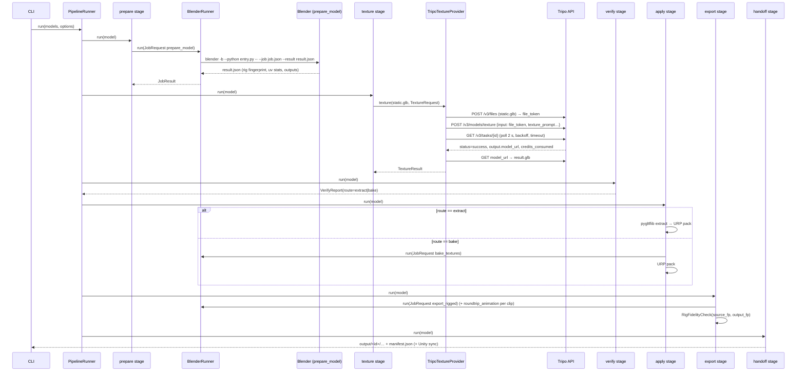

# 03 — Architecture

## 1. Shape of the system

Two Python runtimes and one Unity Editor component, connected only by files and HTTP:

```
┌────────────────────────────── workstation ───────────────────────────────┐
│                                                                          │
│  Orchestrator (project venv, Python 3.12)                                │
│  ┌──────────┐  ┌──────────┐  ┌────────────┐  ┌─────────┐  ┌──────────┐ │
│  │   CLI    │─▶│ Pipeline │─▶│  Stages    │─▶│ Domain  │  │ Observ-  │ │
│  │ (typer)  │  │ runner   │  │ (7 of them)│  │ models  │  │ ability  │ │
│  └──────────┘  └──────────┘  └─────┬──────┘  └─────────┘  └──────────┘ │
│                                    │ ports (Protocols)                   │
│            ┌───────────────────────┼─────────────────────────┐          │
│            ▼                       ▼                         ▼          │
│  ┌──────────────────┐   ┌──────────────────┐     ┌────────────────────┐ │
│  │ BlenderRunner    │   │ TextureProvider  │     │ GLB tools /        │ │
│  │ (subprocess)     │   │ (Tripo client)   │     │ texture packing    │ │
│  └────────┬─────────┘   └────────┬─────────┘     └────────────────────┘ │
│           │ job.json / result.json│ HTTPS                                │
│           ▼                       ▼                                      │
│  ┌──────────────────┐   ┌──────────────────┐                             │
│  │ Blender 4.x -b   │   │ openapi.tripo3d  │                             │
│  │ blender_jobs/*   │   │ .com/v3          │                             │
│  │ (stdlib + bpy)   │   └──────────────────┘                             │
│  └──────────────────┘                                                    │
│                                                                          │
│  Asset library (filesystem) ◀──── every component reads/writes here ──▶  │
│                                                                          │
│  Unity Editor ─ GroundedPipeline postprocessor (C#) reads manifest.json  │
└──────────────────────────────────────────────────────────────────────────┘
```

### Why two runtimes

Blender ships its own Python (3.11 in 4.x) without our dependencies. Rather than pin the whole project
to Blender's ABI (the `bpy` wheel route), the orchestrator runs on its own interpreter and talks to
Blender through a **file-based job protocol**. Blender-side code is restricted to the standard library
plus `bpy`, lives in its own package (`grounded_pipeline.blender_jobs`), and MUST NOT import anything
else from `grounded_pipeline`.

## 2. Layering and dependency rules

```
cli ─▶ pipeline ─▶ stages ─▶ library ─▶ {blender, texturing, gltf, textures, unity} ─▶ tripo ─▶ config ─▶ domain
(library sits above the adapters because validation composes prompts and resolves config)
                     │                                                               ▲
                     └──────────────────────── config ───────────────────────────────┘
observability is importable from every layer; it depends on nothing internal.
blender_jobs depends on NOTHING internal (separate runtime).
```

Rules (enforced by `ruff`'s `TID251`/import-linter contract in CI — WP-00):

1. `domain` imports only stdlib + pydantic. No I/O, no subprocess, no network.
2. `stages` never import `httpx`, `subprocess`, or `bpy`; they use ports (`Protocol`s) injected via
   `PipelineContext`.
3. `blender_jobs` imports only stdlib + `bpy`/`bmesh`/`mathutils`. The repo's `__init__.py` MUST stay
   dependency-free so `import grounded_pipeline.blender_jobs` works inside Blender.
4. `cli` is the only layer allowed to `print`/render to a terminal (through `observability.console`).
5. Tests may import anything.

## 3. Ports and adapters

Every external effect sits behind a `Protocol` so the orchestrator is unit-testable without Blender,
network, or Unity.

| Port (Protocol) | Module | Production adapter | Test adapter |
|---|---|---|---|
| `BlenderRunner` | `grounded_pipeline/blender/runner.py` | `SubprocessBlenderRunner` | `tests/fakes/fake_blender_runner.py` (scripted results) |
| `TextureProvider` | `grounded_pipeline/texturing/provider.py` | `TripoTextureProvider` | `FakeTextureProvider` (returns a synthetic GLB) |
| `TripoApi` | `grounded_pipeline/tripo/client.py` | `TripoClient` (httpx) | `respx` mocked transport |
| `Sleeper` / `Clock` | `grounded_pipeline/pipeline/timing.py` | `time.sleep` / `time.monotonic` | instant fakes |
| `SceneApi` (Blender-side) | `blender_jobs/scene_api.py` | `BpyScene` | `tests/fakes/fake_scene.py` |
| `StateStore` | `grounded_pipeline/pipeline/state_store.py` | `JsonStateStore` (filelock, atomic) | in-memory |

Adapters are thin: translate, call, translate back. Logic lives in pure modules.

## 4. The stage model

A **Stage** is a class with a name, a function that declares its inputs for fingerprinting, and a
`run()` that transforms a `ModelContext`. Stages are composed into a linear graph for v1; the graph
type supports DAGs for the future pipeline.

```python
# grounded_pipeline/pipeline/stage.py  # NORMATIVE
from typing import Protocol
from grounded_pipeline.domain.state import StageName, StageOutcome
from grounded_pipeline.pipeline.context import ModelContext, PipelineContext

class Stage(Protocol):
    name: StageName

    def input_fingerprint(self, model: ModelContext, ctx: PipelineContext) -> str:
        """SHA-256 hex over everything that, if changed, must re-run this stage."""

    def run(self, model: ModelContext, ctx: PipelineContext) -> StageOutcome:
        """Perform the work. MUST be idempotent given the same fingerprint.
        MUST write outputs only under model.paths.work / output / pipeline.
        Raise PipelineError subclasses for failures; never return partial outputs."""
```

v1 graph (`pipeline/graph.py`):

```
discover → prepare → texture → verify → apply → export → handoff
```

Skipping rule: a stage is skipped when `state.stages[name].fingerprint == input_fingerprint()` and all
declared outputs exist. A fingerprint change invalidates that stage **and every downstream stage**.

## 5. Data flow (files)

```
library/models/<id>/
  model.md ──────────────┐
  source/<primary>.fbx ──┤ discover ──▶ .pipeline/state.json (ModelState) ; ModelSpec in memory
  source/animations/*.fbx┘
                          prepare ──▶ work/prepared.blend
                                      work/static.glb
                                      work/prepare_report.json   (rig fingerprint, uv stats, mesh stats)
  references/*.png ─────┐
  library/style/* ──────┤ texture ──▶ work/tripo/request.json
                        │             work/tripo/result.glb
                        │             work/tripo/task.json      (task id, credits, timings)
                          verify  ──▶ work/verify_report.json  (route decision)
                          apply   ──▶ work/textures/raw/*.png  (glTF-convention maps)
                                      work/textures/urp/*.png  (URP-packed)
                          export  ──▶ work/export/<id>.fbx
                                      work/export/animations/*.fbx
                                      work/export/rig_fingerprint_out.json
                                      work/export/rig_fidelity_report.json
                          handoff ──▶ output/<id>/<id>.fbx
                                      output/<id>/textures/*.png
                                      output/<id>/animations/*.fbx
                                      output/<id>/manifest.json
                                      (optional) <unity_import_dir>/<id>/…  (same tree)
```

`work/` is disposable and gitignored. `output/` is the deliverable. `.pipeline/` is state + logs.

## 6. Sequence: one model, full run



## 7. Process and concurrency model

- `PipelineRunner` processes N models concurrently with a `ThreadPoolExecutor(max_workers=concurrency)`.
  Each model runs its stage chain sequentially on one worker thread.
- A `threading.BoundedSemaphore(blender_parallelism)` (default 1) wraps every `BlenderRunner.run`,
  because Blender saturates the CPU; texture stages (network waits) overlap freely.
- Tripo calls are rate-limited client-side by a token bucket (`tripo.max_concurrent_tasks`, default 4,
  and `tripo.min_request_interval_s`, default 0.25).
- State writes go through `JsonStateStore`, which takes a `filelock` on `.pipeline/state.lock` and
  writes atomically (`tmp` + `os.replace`). One model is never processed by two workers in the same run
  (runner de-duplicates by `model_id`); a second concurrent `gp run` on the same library is rejected by
  `.pipeline/run.lock` at the library root.
- Cancellation: `Ctrl-C` sets a `threading.Event`; stages check `ctx.cancelled()` between sub-steps;
  Blender subprocesses are terminated (`terminate()` then `kill()` after 10 s); in-flight Tripo tasks are
  recorded in state so a later run can resume polling instead of paying again.

## 8. Patterns we commit to

| Pattern | Where | Why |
|---|---|---|
| Ports & adapters (hexagonal) | all external effects | Testability without Blender/network |
| Pipeline / Stage with content-addressed caching | `pipeline/` | Idempotent, resumable, cheap re-runs |
| Command objects for Blender work | `blender/protocol.py`, `blender_jobs/` | Serializable, loggable, replayable |
| Strategy | texture route (`extract` vs `bake`), geometry strategy (`subdivide`; later `remesh`) | Isolates variants |
| Parse, don't validate | pydantic at every boundary (model.md, config, API DTOs, job results) | Fail fast with precise messages |
| Pure core, impure shell | heuristics (UV, fingerprints, packing) are pure functions | High coverage with cheap tests |
| Dependency injection via `PipelineContext` | constructor-passed adapters | No globals, no module-level singletons |
| Structured logging with bound context | `structlog` | Every line carries `run_id`, `model_id`, `stage` |
| Result reports as files | `*_report.json` per stage | Debuggable without re-running |

## 9. Extension points reserved for the future pipeline

- `Stage` protocol + `StageGraph` (DAG-capable) — new stages plug in without touching the runner.
- `TextureProvider` sibling ports: `ImageProvider`, `MultiviewProvider`, `MeshProvider`, `RigProvider`
  (declared in `17_future_generative_pipeline.md`; not implemented in v1).
- `GeometryStrategy` seam in `prepare_model` (`subdivide` today; `remesh_transfer` later).
- `library/` layout already reserves `generative/` (see `05_asset_library_layout.md` §7).
- `manifest.json` `schema_version` and `provenance` fields are forward compatible.
